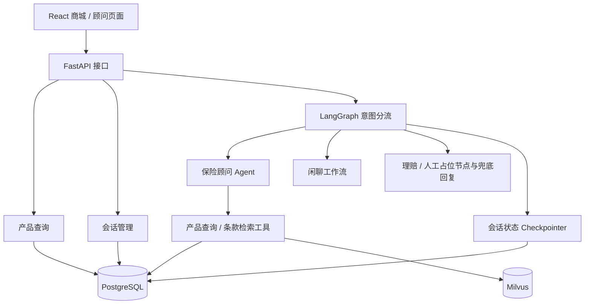

# AI 保险商城 · 安心保

一个将保险产品展示与 AI 顾问结合的保险商城项目。用户可以按险种浏览产品，通过自然语言描述保障需求，向智能顾问咨询产品、获取推荐建议，并检索具体产品的保险条款。

项目采用前后端分离架构：前端使用 React、TypeScript 和 Ant Design，后端使用 FastAPI 提供业务接口，通过 LangChain 与 LangGraph 编排对话工作流，并结合 PostgreSQL、Milvus 实现会话记忆和 RAG 条款检索。

当前版本主要用于学习和演示，已实现产品查询、智能咨询、会话管理及条款知识库；投保、理赔等业务的完成情况见下文。

## 功能介绍

| 模块 | 当前能力 |
| --- | --- |
| 保险产品商城 | 展示产品卡片、产品详情，支持按医疗险、重疾险、寿险、意外险筛选；初始化脚本包含 12 款演示产品 |
| AI 保险顾问 | 根据险种和保费条件查询候选产品，通过工具调用辅助回答产品咨询和推荐问题 |
| 保险条款问答 | 针对指定产品检索条款，结合相关章节内容生成回答 |
| 流式对话 | 通过 SSE 逐步返回 AI 回复，前端支持 Markdown 消息展示 |
| 会话管理 | 支持新建、查询、重命名、删除会话，以及查看历史消息 |
| 多轮记忆 | 使用 PostgreSQL Checkpointer 持久化 LangGraph 状态，按会话恢复对话上下文 |
| 意图分流 | 结合规则和模型区分保险咨询、闲聊、理赔、人工服务等意图，并提供兜底回复 |

### 当前业务边界

- **登录为演示实现**：前端使用固定演示用户和本地会话；会话与聊天接口通过 `x-user-id` 接收用户标识，尚未接入真实登录鉴权。
- **投保为页面演示**：前端包含投保步骤和方案展示相关交互，但当前后端尚未提供保险方案管理、投保状态更新和真实支付接口。
- **理赔与人工服务为占位节点**：目前返回固定提示，尚未接入理赔办理或人工客服系统。

## 技术栈

| 层次 | 技术与用途 |
| --- | --- |
| 前端 | React 18、TypeScript、Vite 6、Ant Design 5 |
| Web 服务 | Python 3.14+、FastAPI、Uvicorn、Pydantic Settings |
| 智能体 | LangChain、LangGraph，负责意图识别、工具调用和工作流编排 |
| 对话模型 | 通过 DashScope 的 OpenAI 兼容接口配置模型 |
| 数据持久化 | PostgreSQL 16、SQLAlchemy 异步 ORM、asyncpg、psycopg |
| 知识库 | MinerU 文档解析、Ollama Embedding、Milvus 向量检索与 BM25 混合检索、DashScope 重排 |
| 部署与工具 | Docker Compose、Nginx、uv、npm、Attu |

## 系统架构



### 条款知识库流程

1. 从数据库读取产品信息，定位 `data/raw/kb/` 中对应的条款 PDF。
2. 使用 MinerU 解析 PDF，再通过模型整理 Markdown 标题结构。
3. 按章节生成父块，进一步切分为用于检索的子块。
4. 父块存入 PostgreSQL，子块通过 Ollama 生成向量后存入 Milvus。
5. 提问时按产品 ID 过滤，进行向量与 BM25 混合检索及语义重排，再读取父块作为顾问回答的上下文。

## 项目结构

```text
ai-insurance/
├── frontend/                    # 商城与 AI 顾问前端
│   ├── src/                     # 商城、聊天、投保演示页面与接口封装
│   ├── .env.example             # 本地开发代理配置示例
│   ├── Dockerfile               # 前端构建与 Nginx 镜像
│   └── nginx.conf               # 静态资源与 API / SSE 代理配置
├── agent-service/               # FastAPI 与智能体服务
│   ├── app/
│   │   ├── agents/              # 意图路由、顾问、闲聊及工具定义
│   │   ├── modules/             # 产品、聊天、会话管理模块
│   │   ├── rag/                 # 文档入库、父子块与检索逻辑
│   │   ├── infra/               # 数据库连接池、Checkpointer
│   │   ├── core/                # 配置、日志、异常处理
│   │   └── main.py              # 应用入口
│   ├── data/raw/kb/             # 保险条款 PDF
│   ├── data/raw/rate_tables/    # 费率表资料
│   ├── scripts/ingest_rag.py    # 条款知识库导入脚本
│   ├── notebooks/              # LangChain、LangGraph 与 RAG 学习示例
│   └── pyproject.toml           # Python 依赖与版本要求
└── deploy/
    ├── docker-compose.yml       # PostgreSQL、Milvus 及配套服务
    ├── docker-compose.silo.yml  # 对象存储 Silo 可选覆盖配置
    ├── postgres/init/           # 建表与演示数据初始化脚本
    └── milvus/user.yaml         # Milvus 重排模型配置
```

## 本地运行

### 1. 准备环境与配置

需要安装 Python 3.14+、uv、Node.js 20+、npm、Docker Compose 和 Ollama，并准备模型服务及 MinerU 的访问凭据。

在 `agent-service/.env` 中配置以下内容。已有配置时按需修改，将示例中的模型名称、接口地址和凭据替换为自己的值：

```dotenv
APP_NAME=安心保AI保险商城
APP_HOST=127.0.0.1
APP_PORT=8001
APP_DEBUG=true
LOGGING_LEVEL=INFO

DB_HOST=127.0.0.1
DB_PORT=5432
DB_NAME=insurance
DB_USER=insurance
DB_PASSWORD=insurance123

DASHSCOPE_NAME=your-dashscope-model
DASHSCOPE_API_KEY=your-dashscope-api-key
DASHSCOPE_BASE_URL=your-openai-compatible-base-url

# 当前配置类要求填写；主对话工作流使用上面的 DashScope 配置
DEEPSEEK_API_KEY=unused-placeholder

MINERU_TOKEN=your-mineru-token
MILVUS_HOST=127.0.0.1
MILVUS_PORT=19530
```

数据库连接参数应与 Compose 配置一致。首次配置 Milvus 时，将 `deploy/milvus/user.example.yaml` 复制为同目录下的 `user.yaml`，再设置 `credential.dashscope_apikey.apikey`，供条款检索的语义重排功能使用。本地 `user.yaml` 已加入 Git 忽略规则，其中的凭据不会自动读取后端 `.env`。

### 2. 启动基础设施

在项目根目录执行。下面使用仓库提供的 Silo 对象存储覆盖配置：

```bash
docker compose -f deploy/docker-compose.yml -f deploy/docker-compose.silo.yml up -d
docker compose -f deploy/docker-compose.yml -f deploy/docker-compose.silo.yml ps
```

Compose 启动 PostgreSQL、etcd、对象存储、Milvus 和 Attu。PostgreSQL 在首次初始化空数据目录时执行建表及演示数据脚本；LangGraph Checkpointer 的表由后端启动时自动创建。

详细的镜像选择、端口和网络说明见 [部署文档](deploy/README.md)。当前 Compose 配置只包含基础设施，前后端按以下步骤单独运行。

### 3. 准备向量模型

确保本机 Ollama 服务已启动，然后下载项目使用的 Embedding 模型：

```bash
ollama pull qwen3-embedding:0.6b
```

当前代码使用 Ollama 默认连接地址，模型名称与 1024 维配置见 `agent-service/app/rag/__init__.py` 和知识库导入脚本。

### 4. 导入知识库并启动后端

从项目根目录进入后端目录，安装依赖：

```bash
cd agent-service
uv sync --locked
```

首次使用条款问答前，在该目录执行导入脚本。导入会调用 MinerU、模型接口和 Ollama，并将结果写入 PostgreSQL 与 Milvus：

```bash
uv run python -m scripts.ingest_rag
```

条款 PDF 文件名需要与数据库产品记录的 `clause_name` 一致。更新条款后可重新运行脚本，它会替换对应产品的旧知识块。

随后启动服务：

```bash
uv run python -m app.main
```

默认地址：

- 健康检查：<http://127.0.0.1:8001/health>
- Swagger 接口文档：<http://127.0.0.1:8001/docs>

### 5. 启动前端

在新的终端中，从项目根目录执行：

```bash
cd frontend
npm ci
npm run dev
```

访问 <http://localhost:5173>。开发服务器默认将 `/api` 代理到 `http://127.0.0.1:8001`，需要调整时将 `frontend/.env.example` 复制为 `frontend/.env.local`，修改 `VITE_BACKEND_HOST` 和 `VITE_BACKEND_PORT`。

点击登录后即可使用固定演示用户进入 AI 顾问页面。可以尝试：

- “我想了解医疗险，有哪些产品？”
- “帮我找最低保费在 500 元以内的意外险产品。”
- “请查询达尔文 12 号的条款，说明等待期和责任免除。”

## 主要接口

| 方法 | 路径 | 说明 |
| --- | --- | --- |
| GET | `/health` | 健康检查 |
| GET | `/api/v1/products` | 产品列表，支持 `category` 筛选 |
| GET | `/api/v1/products/candidates` | 按险种与保费条件查询候选产品 |
| POST | `/api/v1/chat-threads` | 创建会话 |
| GET | `/api/v1/chat-threads` | 查询当前用户的会话列表 |
| PATCH | `/api/v1/chat-threads/{thread_id}` | 重命名会话 |
| DELETE | `/api/v1/chat-threads/{thread_id}` | 删除会话及历史状态 |
| GET | `/api/v1/chat-threads/{thread_id}/messages` | 查询历史消息 |
| POST | `/api/v1/chat` | SSE 流式对话 |

会话与聊天接口需要请求头 `x-user-id`，当前前端演示值为 `1`。发送聊天消息时，请先创建会话，再提交 `thread_id` 和 `message`；响应通过 `message` 事件返回文本片段，通过 `done` 事件标记结束。完整参数以 Swagger 文档为准。

## 后续完善方向

- 接入真实用户认证和权限控制。
- 完善用户需求采集、保险方案生成、方案确认和持久化。
- 实现保费试算、投保、支付与保单管理接口。
- 完善理赔咨询工作流并对接人工客服。
- 增加知识库检索效果评估和业务流程测试。
